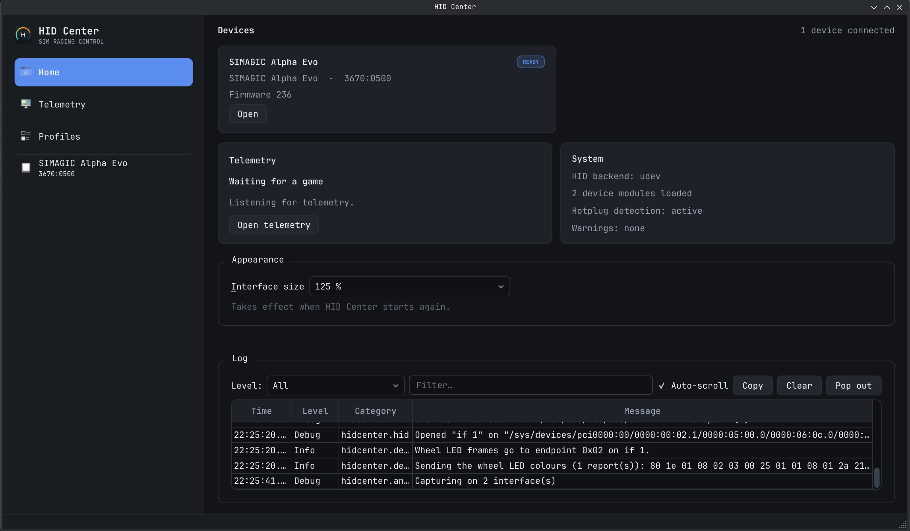
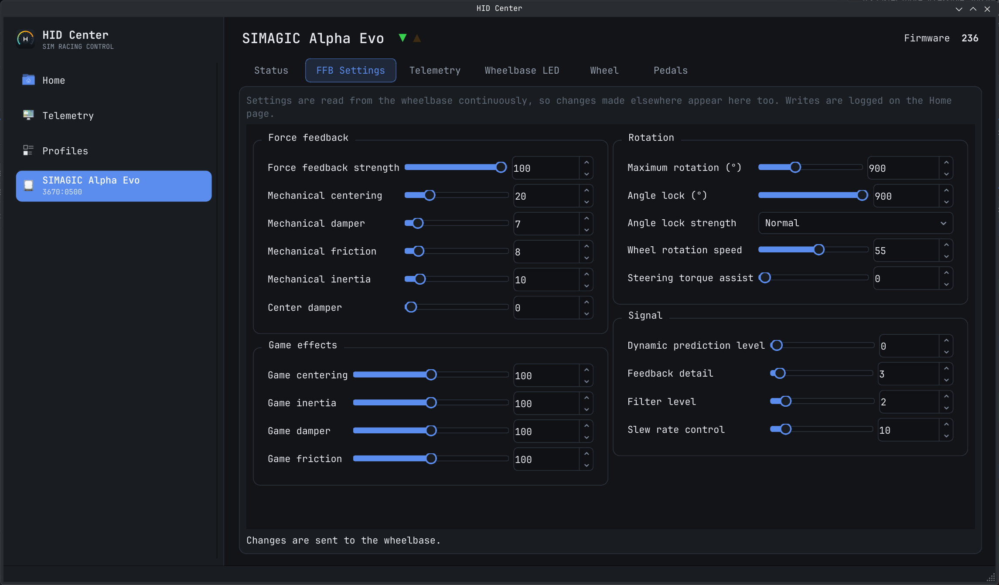
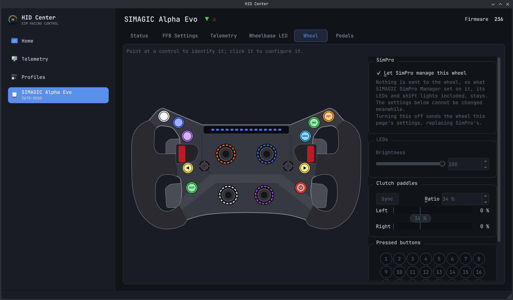
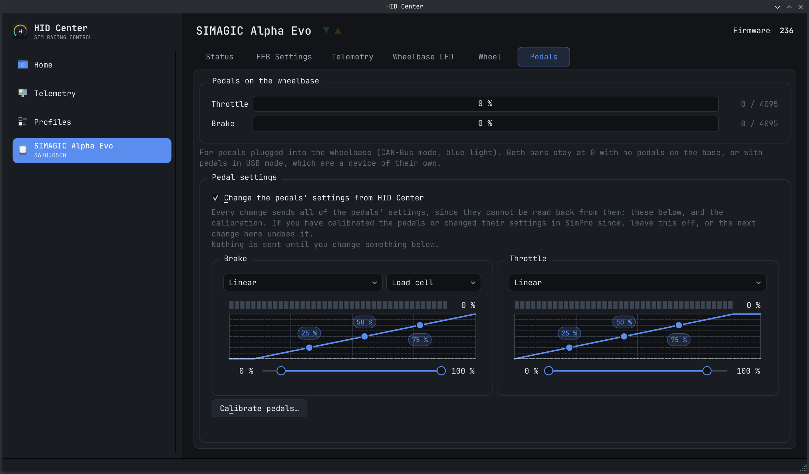

# HID Center

A Qt desktop application for configuring USB HID sim-racing hardware:
force-feedback settings on a direct-drive wheelbase, response curves and
calibration for pedals, wheel LED modes, and live telemetry-driven effects.

> **Fork note:** the hardware work in this fork targets the SIMAGIC Alpha Evo and
> a P1000 pedal set connected to its base. The SIMSONN Plus X module is inherited
> from the original project and has not been verified here.



*The Home dashboard: connected devices, telemetry state, system status and the
application log.*

## Features

- Configure force feedback, rotation, signal and LED settings on SIMAGIC Alpha
  Evo wheelbases.
- Edit pedal curves and ranges, and calibrate the pedals connected to a SIMAGIC
  base. The pedal work in this fork has been developed against a SIMAGIC P1000
  set.
- Set wheel LED colours and modes, including RPM lights.
- Follow telemetry from rFactor 2 and Le Mans Ultimate. A test mode lets the
  telemetry-driven parts of the interface and the devices be used without a sim
  running.
- Save settings as named profiles, apply or update them, and export or import
  them as JSON. A profile can also be associated with a telemetry source and
  applied automatically when that game starts sending telemetry.
- Inspect connected devices, report descriptors, and USB traffic with the
  Protocol Analyzer, enabled with `--dev`.
- Follow the desktop's light or dark colour scheme.

## Screenshots

### Force feedback



*Force-feedback, rotation and signal settings for the wheelbase.*

### Wheel



*The wheel page, with a live schematic of the attached wheel and its settings.*

### Pedals



*Pedal curves, range handles and calibration for pedals connected to the base.*

## Profiles

Settings can be saved as named profiles from the **Profiles** page, applied to a
matching device, duplicated, and exported or imported as JSON. A profile can also
be associated with a telemetry source; when that source starts sending, its
profile is applied automatically. Profiles currently cover force feedback and the
pedals on a SIMAGIC base. The inherited SIMSONN module also exposes profile data,
but that hardware has not been verified in this fork.

## Telemetry

The bundled telemetry source listens on `127.0.0.1:56789` for rFactor 2 /
Le Mans Ultimate `TelemInfoV01` datagrams. The **Telemetry** page shows the live
values, which source is sending, and a test mode that lets values be driven by
hand. Device modules and profiles consume the same shared frame.

## Supported devices

| Device | VID:PID | Notes |
| --- | --- | --- |
| SIMAGIC Alpha Evo | `3670:0500` | Tested with a P1000 pedal set on the base. |
| SIMAGIC Alpha Evo | `3670:0501` | Same module as `3670:0500`. |
| SIMAGIC Alpha Evo | `3670:0502` | Same module as `3670:0500`. |
| SIMSONN Plus X | `ddfd:6011` | Inherited from the original project; not verified in this fork. |

## Building

Needs CMake ≥ 3.21, a C++20 compiler, Qt 6.2+ (Widgets) and, on Linux, `libudev`.

```sh
cmake -S . -B build -G Ninja
cmake --build build
./build/hid-center
```

## Device access

`/dev/hidraw*` is root-only by default, so install the udev rules or devices will be listed
but fail to open:

```sh
sudo cp udev/70-hid-center.rules /etc/udev/rules.d/
sudo udevadm control --reload-rules
sudo udevadm trigger
```

## Disclaimer

HID Center is an independent project. It is not affiliated with, endorsed by or supported by
SIMAGIC, SIMSONN or any other hardware maker. Product and company names are trademarks of their
owners and are used only to say which devices the application works with.

How these devices talk was worked out by watching their USB traffic and trying things on real
hardware, not from the makers' own software or documentation. Some of it is guesswork. Writing
settings to a device can change how it behaves, and the application is used entirely at your own
risk; see the warranty disclaimer in the license.

## Support

HID Center was made to solve the author's own needs, and is shared in case it is useful to others.
There is no promise of support: issues and pull requests are welcome, but they may go unanswered,
and the application may not suit your hardware or setup.

## AI-assisted development

Most of this project was written with the help of AI coding assistants, guided and reviewed by
the author, and tested on real hardware. Treat it accordingly, and please report anything that
looks wrong.

## License

HID Center is free software, licensed under the
[GNU General Public License, version 3 or later](LICENSE). It links against Qt, used under the
terms of the LGPL v3, and against `libudev` (LGPL v2.1 or later), both dynamically.
